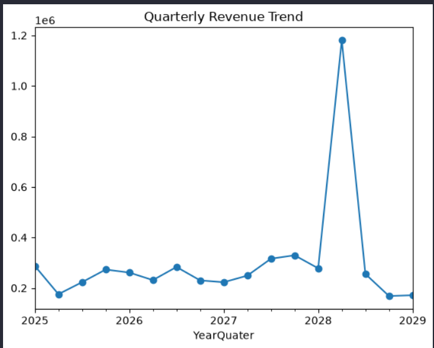
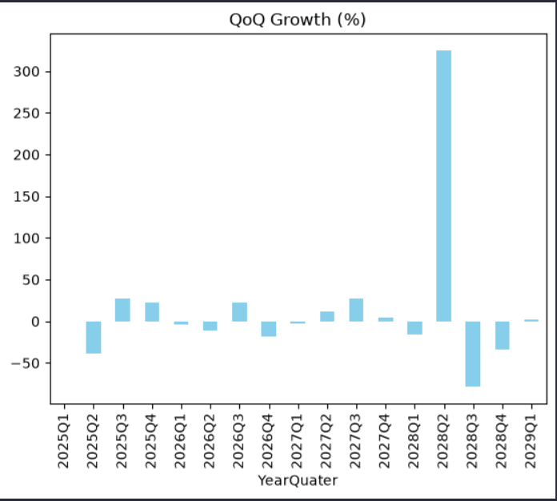
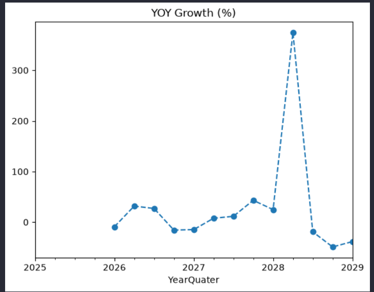
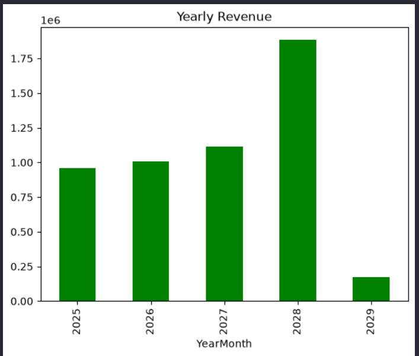
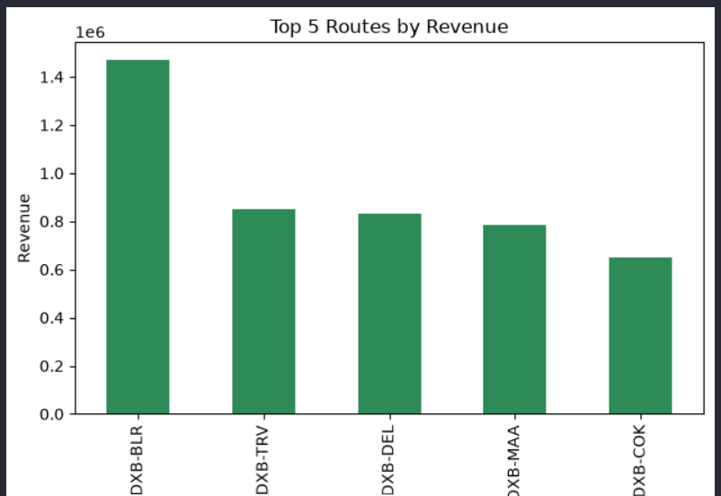

# Airline-Revenue-Growth-Analysis 📈

Python mini project analysing airline revenue growth trends. Includes data aggregation, growth rate calculations (MoM, QoQ, YoY), and visualizations of top vs weak routes. Provides insights and recommendations for sustainable revenue expansion.
	
Python Mini Project 2 // Airline Revenue

## Objective

Analyze airline revenue trends across quarters and years to identify growth patterns, route performance, and business opportunities.

## Folder Structure

├── Data/               # raw datasets (synthetic) 
├── Notebooks/          # Jupyter notebooks or Python scripts  
├── Visuals/            # charts and graphs (PNG, JPG)  
├── README.md           # project documentation  
└── Requirements.txt    # list of Python libraries

## Methodology

1. Created a synthetic airline revenue dataset.
2. Added real-world data quality issues (missing values, duplicates, spelling errors, and outliers).
3. Performed data cleaning and preprocessing.
4. Calculated route contribution percentages.
5. Analyzed quarterly and yearly revenue trends.
6. Measured QoQ and YoY growth rates.
7. Visualized revenue performance and route rankings.

## Visuals

### Quarterly Revenue Trend

### QoQ Growth (%)

### YoY Growth (%)

### Yearly Revenue

### Top 5 Routes by Revenue

## Visual Summary

| Visualization           | Key Insight               | Explanation                                                         |
|-------------------------|---------------------------|---------------------------------------------------------------------|
| Quarterly Revenue Trend | Revenue Growth Pattern    | Quarterly revenue highlights growth and decline patterns over time. |
| QoQ Growth (%)          | Short-Term Momentum       | Measures revenue growth compared with the previous quarter.         |
| YoY Growth (%)          | Long-Term Growth          | Compares the same quarter across different years.                   | 
| Yearly Revenue          | Annual Performance Review | Summarizes yearly revenue performance and overall business growth.  |
| Top 5 Routes by Revenue | Revenue Driving Routes    | Identifies routes contributing the highest revenue.                 |

## Insights											

- Quarterly revenue trends reveal fluctuations in demand across different periods.
- QoQ growth helps measure short-term business momentum.
- YoY growth provides a long-term view of revenue performance.
- A small number of routes contribute a significant share of total revenue.
- Revenue concentration highlights the importance of monitoring key routes.

## Recommendations

- Focus commercial efforts on the highest revenue-generating routes.
- Monitor routes showing declining QoQ performance.
- Use YoY trends for annual planning and forecasting.
- Reduce dependency on a small number of routes by improving weaker routes.
- Continuously track revenue growth metrics for better decision-making.

## Tech Stack

- Python (Pandas, NumPy, Matplotlib)
- Jupyter Notebook
- GitHub for Version Control
